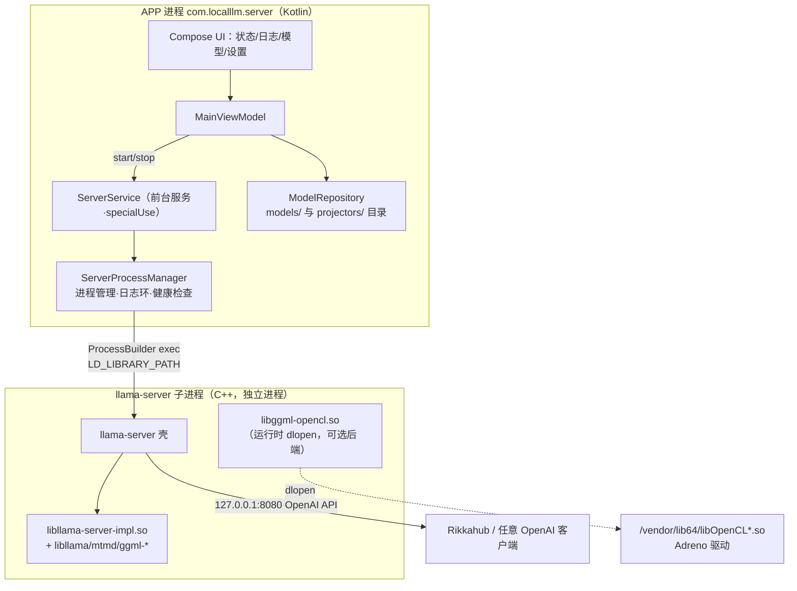

# 架构说明（ARCHITECTURE）

## 一、总览

## 二、进程模型（核心设计）

**APP 与引擎之间只有一条边界：exec 子进程 + 命令行参数 + OpenAI HTTP。**

- Kotlin 层**不链接**任何 llama.cpp C++ 接口（无 JNI 依赖），升级引擎不影响 APP 代码结构
- 这条边界选得刻意：llama.cpp 不保证 C++ 库 ABI 稳定，但 **CLI 参数和 OpenAI API 是它的公共契约**
- 子进程崩溃不影响 APP；APP 通过 stdout 采集日志、轮询 `/health` 判活

### 启动链

1. UI 点「启动服务」→ `ServerService.start()`（foreground service）
2. `onStartCommand` **首先** `startForeground`（否则 Android 5 秒超时直接崩，见 TROUBLESHOOTING #1）
3. `ServerProcessManager.start()` 拼 CLI → `ProcessBuilder` exec
4. reader 协程采集 stdout → 日志环（500 行）+ logcat（tag `ServerProcess`）
5. health 协程每 2s GET `/health`，200 → 状态「运行中」

### exec 的三条硬约束（改这里前必读）

| 约束 | 原因 | 对策（已固化在代码里） |
|---|---|---|
| **targetSdk 必须 = 28** | untrusted_app_34（target≥34）被 SELinux 禁止 `execute_no_trans` 执行 app 数据目录文件；untrusted_app_28 允许（Termux 同款） | `app/build.gradle.kts` 有注释保护，勿随意提升 |
| **LD_LIBRARY_PATH 三段顺序** | `files/native`（系统 libc++ 副本，防 vendor libc++ 遮蔽致 liblog 符号缺失）→ `/vendor/lib64`（Adreno libOpenCL）→ `jniLibs`（llama 本体） | `ServerProcessManager.start()` 内，顺序不可调 |
| **二进制放 files/native/，.so 放 jniLibs** | 可执行从 assets 释放+chmod755；.so 需 `extractNativeLibs=true` 解压成真实文件才能被 LD 路径找到 | Manifest + `BinaryInstaller` |

## 三、模块职责

| 模块 | 文件 | 职责 |
|---|---|---|
| 二进制安装 | `core/BinaryInstaller.kt` | assets→files/native 释放、版本标记、系统 libc++ 副本、Adreno OpenCL 库副本清理 |
| 进程管理 | `core/ServerProcessManager.kt` | 启动/停止/日志环/健康检查/CLI 拼装（全部 llama 参数从这里出） |
| 前台服务 | `core/ServerService.kt` | FGS 生命周期、通知、Intent 控制面（ACTION_START/STOP） |
| 模型仓库 | `core/ModelRepository.kt` | `files/models/`（对话模型）与 `files/projectors/`（mmproj）**按目录分类型，与文件名无关**；SAF 导入；旧版按文件名自动迁移 |
| 设置 | `core/AppSettings.kt` | SharedPreferences：端口/ctx/线程/ngl/KV类型/投机解码/局域网/令牌/主模型/mmproj选配 |
| UI | `ui/*` | 四屏 Compose；导入时 AlertDialog 选类型；mmproj 单选含「不使用」 |

## 四、关键设计决策记录（ADR）

1. **路线：exec 子进程 vs JNI 内嵌** → 选 exec。llama-server 原生提供完整 OpenAI 兼容层（SSE、tool calling、jinja、多模态、投机解码），JNI 路线要重写整个 HTTP 层（OlliteRT 的 service 层有几十个类）。代价是 exec 三条硬约束，均已解决。
2. **targetSdk=28 而非 36** → 唯一能在 Android 17 上执行 app 私有二进制的域。副作用大多有利：通知权限安装即授予、FGS 类型校验放宽。Play 上架时才需重新评估。
3. **GPU 后端：OpenCL 而非 Vulkan** → 官方有 Android+OpenCL 完整文档；Adreno 设备验证通过（kgsl 映射铁证）。Vulkan 交叉编译需要主机 C++ 工具链（w64devkit），在国内网络下被限速卡住，降级为 backlog。`libggml-opencl.so` 是运行时按需加载的独立后端，**无 OpenCL 的设备自动退回 CPU，不会崩**。
4. **mmproj 按目录 + 导入时选类型** → 文件名与类型解耦（用户任意命名）；选配可空（不选不拼 `--mmproj`）。
5. **`--jinja` 默认开启** → 现代模型（尤其 Qwen-VL 多模态）没有完整 jinja 模板会输出乱码（已实证）。
6. **引擎更新策略：随 APK 内置**（决策日期：2026-10）→ 引擎包在线更新为"预留期权"：CI 应生成引擎产物 + 清单格式（版本/SHA256/min_app_version），APP 下载器等出现真实痛点再做。理由：单人维护，发版频率低，独立更新器的运维复杂度 > 收益。

## 五、数据与状态

- 模型文件：`files/models/*.gguf`、`files/projectors/*.gguf`（SAF 导入时拷入，删除不碰原文件）
- 设置：SharedPreferences `llama_server_settings`
- 服务状态：进程内单例 StateFlow（进程死即归零，不持久化）
- 日志：内存环 500 行 + logcat（**注意 logd chatty 会合并相似行，排障以完整命令回显为准**）
