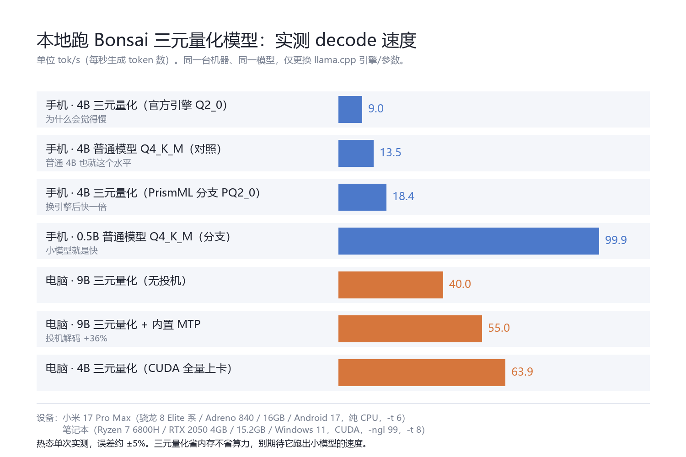

# Bonsai 三元量化模型 实测测评 + 安装使用教程

> 测试对象：Bonsai 2 系列（PrismML / 2B·4B·9B·27B），GGUF 格式
> 测试时间：2026-10-18
> 数据来源：本机实测，非厂商宣传数字。单机单次测量，热态运行，误差约 ±5%。



---

## 一、一句话结论

**Bonsai 这套东西的关键不在模型，在你用哪个版本的 llama.cpp。**

同一台机器、同一个模型文件，换上 PrismML 官方分支编译的 llama.cpp 之后：
- 手机（纯 CPU）跑 4B 三元量化：9.0 → **18.4 tok/s**（快一倍）
- 电脑（CUDA）跑 4B：**63.9 tok/s**，比同尺寸的普通 Q4 模型还快一点
- 9B 版再开模型自带的 MTP 投机解码：40.0 → **55 tok/s**（快 36%）

代价是：官方 llama.cpp 只认其中一种打包格式，另外两种必须用他们的分支；而且**没有一个能像宣传那样"4B 当 0.5B 用"**（后面有数据）。

---

## 二、测试环境（硬件参数）

| | 手机 | 电脑 |
|---|---|---|
| 机型 | 小米 17 Pro Max（2509FPN0BC） | 笔记本 |
| 系统 | Android 17 / API 37（HyperOS 4） | Windows 11 |
| CPU | 骁龙 8 Elite 系（8 核） | AMD Ryzen 7 6800H（8 核 16 线程） |
| GPU | **Adreno 840** | **NVIDIA RTX 2050 Laptop，4GB 显存** |
| 内存 | 16 GB | 15.2 GB |
| 存储 | 512 GB | SSD，可用 111 GB |
| 推理方式 | 手机 App 内置 llama.cpp，纯 CPU（`-t 6`） | PrismML 分支 llama.cpp，CUDA 全量上卡（`-ngl 99`） |
| 对比基线引擎 | 上游 llama.cpp v0.7.0（commit 620d2225c） | — |

> 说明：手机端的"特别版引擎"是 PrismML 分支的 Android arm64 构建，**纯 CPU**（不含 OpenCL 后端），所以手机 GPU 那条路仍然走上游引擎。

---

## 三、Bonsai 三种打包格式：到底哪个能用

这是全网最容易踩的坑——同一个模型仓库里躺着 5 个文件，只有 1 个能用。

| 文件名 | 张量类型 | 官方 llama.cpp | PrismML 分支 | 说明 |
|---|---|---|---|---|
| `*-Q2_0.gguf` | 42 | ✅ 能 | ✅ 能 | **首选，通用** |
| `*-Q1_0.gguf`（Bonsai 1 的 1-bit） | 41 | ✅ 能 | ✅ 能 | 能跑但很慢 |
| `*-PQ2_0.gguf` | 142 | ❌ 不认 | ✅ 能 | 快的那一档，要分支 |
| `*-PTQ1_0.gguf` | fork 专属 | ❌ | ✅ | 体积最小 |
| `*-DFlash2-*.gguf` / `*-dspark-*.gguf` | arch=dflash/dspark | ❌ | ❌ | **不是聊天模型**，是投机解码草稿 |
| `*-mmproj-*.gguf` | arch=clip | — | — | 视觉投影器，配 `--mmproj` |

**判据不是文件名，是 GGUF 头的元数据**：`general.type`（model/mmproj/adapter）+ `general.architecture`（qwen35=主模型、clip=投影器、dflash/dspark=草稿）。

为什么强调这个：`MTP` 出现在文件名里有**两种含义**——`Qwen3.5-9B-...-MTP-IQ4_XS.gguf` 是"主模型自带 MTP 头"，而 `Ternary-Bonsai-2-9B-PQ2_0-MTP-Q8_0.gguf` 实测也是主模型（`size_label=9B`、`arch=qwen35`），但 `*-PQ2_0-MTP-Q8_0.gguf` 若出现在别的仓库就可能是独立侧车。**只认元数据。**

---

## 四、PC 实测数据

引擎：PrismML 分支 `build 10777`，CUDA，`-ngl 99`，`-t 8`。

| 模型 | 上下文 | 投机解码 | prefill | decode | 显存/内存占用 |
|---|---|---|---|---|---|
| Bonsai 2 **4B PQ2_0** | 8192 | 关 | **840 tok/s** | **63.9 tok/s** | 约 3.6 GB 显存 |
| Bonsai 2 **9B PQ2_0-MTP** | 4096 | 关 | — | 40.0 tok/s | 2.6 GB |
| Bonsai 2 **9B PQ2_0-MTP** | 4096 | **开（内置 MTP）** | — | **55 tok/s** | 2.6 GB |

补充数据：
- 4B 开视觉（`-mmproj Ternary-Bonsai-2-4B-mmproj-Q8_0`）实测能正确读图，回答"图片里有一个蓝色的椭圆和一个红色的矩形"，decode 66.4 tok/s，视觉对解码速度基本无影响。
- 9B 开 MTP 时日志给出草稿命中率：`draft acceptance = 0.676`（92 接受 / 136 生成），平均一次猜 3.63 个 token。
- **草稿必须同血统**：9B 的 DFlash2 草稿配 9B PQ2_0-MTP 主模型，加载即崩（`invalid vector subscript`）。所以外部草稿不建议自动启用。

---

## 五、手机实测数据

引擎：App 内置。上游引擎 = llama.cpp v0.7.0；特别版 = PrismML 分支 arm64（纯 CPU），`-t 6`。

| 模型 | 引擎 | 上下文 | prefill | decode | 备注 |
|---|---|---|---|---|---|
| Bonsai 2 **4B Q2_0** | 上游 | 131072 | ~14 | **9.0 tok/s** | 就是这个"慢到像坏了" |
| Bonsai 2 **4B PQ2_0** | 特别版 | 4096 | 25.5 | **18.4 tok/s** | 快一倍 |
| Bonsai 2 **9B Q2_0** | 上游 | 131072 | — | 5.2 tok/s | 9B 在手机上确实吃力 |
| Bonsai 1 **8B 1-bit** | 上游 | 32768 | — | 6.6 tok/s | 需把上下文降到 32k |
| 普通 **Qwen3.5-4B Q4_K_M** | 上游 | 32768 | 19.9 | 13.5 tok/s | 对照组 |
| 普通 **Qwen3.5-4B Q4_K_M** | 特别版 | 32768 | — | 15.4 tok/s | 特别版对普通模型也更快 |
| 普通 **qwen2.5-0.5B Q4_K_M** | 上游 | 32768 | 137 | 79.7 tok/s | 轻量对照 |
| 普通 **qwen2.5-0.5B Q4_K_M** | 特别版 | 65536 | 267 | **99.9 tok/s** | KV 量化 q8_0 时 107.0 |

内存占用（llama-server 进程 RSS，上下文 32768）：
- 0.5B Q4_K_M：1311 MB
- Bonsai 2 2B Q2_0：1127 MB
- Bonsai 2 4B Q2_0：**2907 MB**

**关于"4B 占用相当于 0.5B"这句宣传**：只在"权重文件体积"这一项上成立——4B 三元量化 1.21GB，对标的是 0.5B 的 **FP16**（约 1.0GB）。实际运行内存是 0.5B-Q4 的 2.2 倍（2907 vs 1311 MB），速度是它的 1/9。三元量化省的是存储和权重内存，**算力一点没省**。

---

## 六、PC vs 手机

| 项目 | 电脑（RTX 2050 4GB） | 手机（Adreno 840 / CPU） | 差距 |
|---|---|---|---|
| 4B 三元量化 decode | 63.9 tok/s | 18.4 tok/s | 约 3.5 倍 |
| 4B 三元量化 prefill | 840 tok/s | 25.5 tok/s | 约 33 倍 |
| 9B decode（开 MTP） | 55 tok/s | 手机上未跑通（缺模型） | — |
| GPU 加速可用性 | CUDA ✅（PrismML 分支） | ❌ 分支无 OpenCL，只能 CPU | — |
| 4B 权重体积 | 1.07–1.21 GB | 同 | — |

**结论**：
1. Prefill（读长文档、塞大段上下文）电脑碾压，差 30 倍以上，这部分差距是显存带宽决定的。
2. Decode（逐字生成）差距小得多，只有 3.5 倍，手机完全可用。
3. 手机真正的瓶颈不是算力而是**散热和上下文**：9B/131k 上下文这种组合在手机上既不快也撑不住，4B + 4k 上下文才是甜点。

---

## 七、踩坑清单（8 条，全都实测过）

1. **下了草稿当主模型**：`*-DFlash2-*.gguf` 是投机解码草稿，单独加载报 `dflash requires ctx_other to be set`，然后退出。它的 `size_label` 只有 2.4B，看着像小模型，其实是"给 9B 用的草稿"。
2. **下了 fork 专属格式**：`PQ2_0`（类型 142）/`PTQ1_0` 在官方 llama.cpp 里根本没有这个类型，报 `failed to load model`。必须换 PrismML 分支。
3. **上下文开太大**：Bonsai 1 的 8B 训练上下文只有 65536，App 里设 131072 会触发 `n_ctx_seq > n_ctx_train` 加内存 fitting 失败，服务起不来。降到 32768 正常。
4. **4GB 显存塞 9B**：2.5GB 权重 + 8k 上下文 + MTP 上下文放不下，进程直接异常终止（`0xC0000409`），不是优雅报错。9B 用 4096 上下文才稳。
5. **MTP 头被忽略**：模型名里带 MTP 不等于自动启用。不传 `--spec-type draft-mtp` 时日志会警告 `unused tensor blk.32.nextn.shared_head_norm.weight`，白白浪费 36% 的速度。
6. **投影器配错**：投影器必须和主模型同尺寸（4B 配 4B），n_embd 不一致会报 `mismatch between text model (n_embd = …) and mmproj (n_embd = …)`。而且它容易"泄漏"给别的模型——App 里给它单独绑定最保险。
7. **草稿不同血统**：尺寸对上了也可能崩。9B DFlash2 草稿 + 9B PQ2_0-MTP 主模型 → `invalid vector subscript`。
8. **以为慢是引擎退化**：其实同一引擎下热态/冷态能差 25%，连续跑三轮还会因为 GPU 热衰减掉 30%（33.8 → 23.5 tok/s）。测速一定要跑热、跑两次取稳定值。

---

## 八、安装教程 · 电脑（Windows）

### 8.1 准备

1. 建一个文件夹，比如 `D:\Bonsai\`，里面再建两个子目录：`llama\`、`models\`。
2. 确认显卡驱动是新版（NVIDIA 用 `nvidia-smi` 能出版本号即可）。

### 8.2 下载 PrismML 分支的 llama.cpp（不用自己编译）

打开 https://github.com/PrismML-Eng/llama.cpp/releases ，找 `prism-*` 那个 tag，按你的显卡选：

| 你的情况 | 下这个 |
|---|---|
| NVIDIA 显卡（显存 ≥4GB） | `llama-prism-*-bin-win-cuda-12.4-x64.zip` |
| 同时还要 CUDA 运行库 | `cudart-llama-bin-win-cuda-12.4-x64.zip` |
| 没有 NVIDIA（AMD/Intel 集显） | `llama-prism-*-bin-win-vulkan-x64.zip` |
| 完全不想折腾显卡 | `llama-prism-*-bin-win-cpu-x64.zip` |

> 国内直连 GitHub Releases 很慢（实测 20 分钟只下到 100MB/314MB），加镜像前缀快十倍：
> `https://gh-proxy.com/https://github.com/...`（实测 ~800KB/s）

全都解压进 `D:\Bonsai\llama\`（注意：CUDA 包和 cudart 包解压到**同一个目录**，缺 cudart 会报 `0xC0000135`）。

### 8.3 下载模型

国内用 HF 镜像：
```
https://hf-mirror.com/prism-ml/Ternary-Bonsai-2-4B-gguf/resolve/main/Ternary-Bonsai-2-4B-PQ2_0.gguf
https://hf-mirror.com/prism-ml/Ternary-Bonsai-2-4B-gguf/resolve/main/Ternary-Bonsai-2-4B-mmproj-Q8_0.gguf
```
都放进 `D:\Bonsai\models\`。

> 想跑 9B，把 `4B` 换成 `9B`，文件名用 `Ternary-Bonsai-2-9B-PQ2_0-MTP-Q8_0.gguf`（这个才是主模型，别下 DFlash2 那个草稿）。

### 8.4 启动

在这个目录建一个 `启动.bat`：

```bat
@echo off
cd /d "%~dp0llama"
llama-server.exe -m "..\models\Ternary-Bonsai-2-4B-PQ2_0.gguf" ^
  --mmproj "..\models\Ternary-Bonsai-2-4B-mmproj-Q8_0.gguf" ^
  -c 8192 -ngl 99 -t 8 --host 0.0.0.0 --port 8081
pause
```

双击，看到 `listening on http://0.0.0.0:8081` 就成功了。浏览器打开 `http://127.0.0.1:8081/` 直接聊天。

**参数速查**：

| 参数 | 含义 | 建议 |
|---|---|---|
| `-c` | 上下文长度 | 4B 用 8192，9B 用 4096，2B 可以 32768 |
| `-ngl` | 上卡层数 | 99=全上；报显存不足就 20 → 0 |
| `-t` | CPU 线程 | 填物理核数（8 核写 8） |
| `--host` | 监听地址 | 127.0.0.1=只本机；0.0.0.0=手机也能连 |
| `--api-key` | 访问令牌 | 开了 0.0.0.0 强烈建议设 |
| `--spec-type draft-mtp` | 用内置 MTP 加速 | 9B 的 MTP 版可加，+36% |
| `--no-mmproj-offload` | 投影器放内存 | 4GB 显存建议加 |

### 8.5 手机接入电脑的模型（可选）

1. `ipconfig` 查电脑 IPv4，比如 `192.168.31.132`
2. 手机 App → 设置 → 模型渠道 → 新增：地址 `http://192.168.31.132:8081`，密钥填你设的 `--api-key`
3. 同一 WiFi 下即可用手机 App 调用电脑的算力（实测可用）

---

## 九、安装教程 · 手机（Android）

### 9.1 上游引擎（最省事，只能跑 Q2_0 / Q1_0）

1. 装 App（本项目 APK），打开 → 状态页 → 启动服务
2. 模型页 → 右上「导入 GGUF」→ 选 `*-Q2_0.gguf`
3. 状态页 → 启动 → 聊天页就能用
4. 想看图：模型页把对应 `*mmproj*` 选为「多模态投影」

这条路上 4B 三元量化大约 **9 tok/s**，能跑但谈不上爽。

### 9.2 特别版引擎（跑 PQ2_0，速度翻倍）

1. 设置 → 服务设置 → 往下滚到「GPU 层数」下面，打开 **「Bonsai 优化引擎（PrismML fork）」**
2. 保存（会提示"重启服务生效"）
3. 状态页 → 停止 → 启动
4. 日志里出现 `引擎：prism（PrismML fork，支持 PQ2_0/PTQ1_0）` 就对了
5. 这时导入 `*-PQ2_0.gguf`，实测 4B **18.4 tok/s**

注意事项：
- 这个开关**只在 ngl=0（纯 CPU）时生效**，fork 没有 OpenCL 后端，开 GPU 时仍用上游引擎
- 切换引擎要"停止→启动"一次，不用重装 App
- 一个模型对应一条模型级参数（上下文/mmproj），换模型记得看一眼

---

## 十、怎么选（直接抄作业）

| 你的设备 | 建议配置 | 预期速度 |
|---|---|---|
| 手机 16GB（如小米 17 Pro Max） | 特别版引擎 + **Bonsai 2 4B PQ2_0** + 上下文 4096 + 关视觉 | 18 tok/s |
| 手机 12GB | 特别版引擎 + **Bonsai 2 2B Q2_0** + 上下文 8192 | 26 tok/s |
| 手机想省电/长续航 | 上游引擎 + 普通 0.5B~2B 的 Q4_K_M | 80~100 tok/s |
| 笔记本 4GB 显存（如 RTX 2050） | 分支 + CUDA + **4B PQ2_0** + `-ngl 99` + 上下文 8192 | 64 tok/s |
| 笔记本想跑 9B | 分支 + **9B PQ2_0-MTP** + 上下文 4096 + `--spec-type draft-mtp` | 55 tok/s |
| 显卡 ≥12GB | 9B + 32k 上下文 + MTP | 更快，可全量上卡 |

一句话：**手机上 4B 是甜点，电脑上 9B 才开始有"能干活"的感觉**。

---

## 十一、常见问题

**Q：三元量化是不是比 Q4 更快？**
不是。它省的是**存储和内存**，算力一点没省。实测手机上 4B 三元量化 18 tok/s，而普通 0.5B-Q4 能到 100 tok/s，普通 4B-Q4 是 13.5 tok/s。三元量化的价值是"同样内存塞下更大的模型"。

**Q：为什么我的 Bonsai 只有 9 tok/s？**
大概率在用官方 llama.cpp 跑 Q2_0。同一台机器换 PrismML 分支后能到 18 tok/s。

**Q：PQ2_0 和 Q2_0 选哪个？**
能上分支就选 PQ2_0（快、小）；只能用官方 llama.cpp 就选 Q2_0（通用）。

**Q：能不能只用手机、不联网？**
可以。全流程（模型、推理、聊天）都在本地，实测手机端 RAG/工具调用也都是本机跑。

**Q：模型能商用吗？**
Bonsai 2 是 Apache-2.0，可商用；但三元量化权重、以及各社区微调版本的许可要各自确认。

**Q：为什么 9B 在手机上这么慢？**
不是量化的问题，是 9B 每生成一个 token 都要过 9B 次乘加，手机 CPU 算不过来。同理上下文越长越慢，且发热会掉频。

---

## 附录 A：小红书文案（三选一，可直接发）

### A1 · 测评向

**标题**：同一个模型，换个引擎快一倍

**正文**：
最近在折腾 Bonsai 这套三元量化模型（1.58 bit，4B 只有 1.2GB），发现一个反常识的结论：

模型没变，只把 llama.cpp 换成官方分支编译的版本，手机上从 9 tok/s 涨到 18.4 tok/s，整整一倍。

实测数据（小米 17 Pro Max / 16GB / 纯 CPU）：
· 4B 三元量化：上游 9.0 → 分支 18.4 tok/s
· 普通 4B Q4 做对照：13.5 tok/s
· 0.5B Q4：79.7 → 99.9 tok/s

电脑上（RTX 2050 4GB / CUDA）：
· 4B：64 tok/s，读 1000 token 的提示只要 1.2 秒
· 9B 开模型自带 MTP 投机解码：40 → 55 tok/s，草稿命中率 68%

然后说点宣传里不会写的：
"4B 占用相当于 0.5B"只对**权重文件**成立（1.2GB ≈ 0.5B 的 FP16）。实际运行内存是 0.5B-Q4 的 2.2 倍，速度是它的九分之一。三元量化省内存，不省算力。

坑也不少：仓库里 5 个文件只有 1 个能用；DFlash2 不是聊天模型而是草稿；上下文开大了直接起不来。

完整数据、踩坑清单和两套安装教程都整理好了，评论区问具体的我尽量回。

**标签**：#本地大模型 #Bonsai #llamacpp #AI量化 #手机跑大模型 #边缘推理 #安卓开发

### A2 · 教程向

**标题**：手机本地跑 4B 大模型：18 tok/s 配置清单

**正文**：
不联网、不上云，手机本地跑 4B 模型，18 tok/s，全程离线。

三步：
1. 装带"特别版引擎"的 App（内置 PrismML 分支编译的 llama.cpp）
2. 设置里打开「Bonsai 优化引擎」开关，重启服务
3. 导入 `Ternary-Bonsai-2-4B-PQ2_0.gguf`（1.2GB），上下文设 4096

实测：4B 三元量化 18.4 tok/s，2B 能到 26 tok/s，普通 0.5B-Q4 有 100 tok/s。

三个必须知道的坑：
· 模型仓库里 `Q2_0` 通用、`PQ2_0` 要分支引擎、`DFlash2` 是草稿不是模型
· 投影器（视觉）必须和主模型同尺寸，不然报 n_embd 不匹配
· 上下文不是越大越好，手机上 4B 用 4096~8192 最稳

电脑端教程 + 手机接电脑算力的方法也一起整理了。

**标签**：#本地部署 #大模型 #安卓App #离线AI #私有化部署

### A3 · 对比向

**标题**：同一台手机，4B 三元量化 vs 普通 0.5B

**正文**：
一边是 1.2GB 的 4B 三元量化，一边是 0.5GB 的普通 0.5B-Q4，同一台手机实测：

· 速度：4B 18.4 tok/s vs 0.5B 100 tok/s，差了 5 倍
· 内存：4B 2.9GB vs 0.5B 1.3GB
· 质量：4B 明显更能"听懂人话"

结论：三元量化买的是**质量密度**，不是速度。想快就用小模型，想聪明就接受慢一点。

---

## 附录 B：B 站视频脚本大纲（6~8 分钟）

**标题建议**：《同一个模型换个引擎快一倍？Bonsai 三元量化实测（手机 + 电脑）》

**P1 · 开场（0:00-0:40）**
- 画面：手机上流式出字 + tok/s 数字
- 口播：今天测一个"1.58 bit"的模型，4B 只有 1.2GB。先说结论：模型没变，把 llama.cpp 换个版本，速度翻倍。

**P2 · 这模型是什么（0:40-1:40）**
- 画面：三元量化示意（-1/0/+1 三个值 + Hadamard 变换）
- 口播：每权重 1.58 bit，靠 Hadamard 旋转和符号翻转保住精度。注意它必须配支持这套变换的引擎，否则能加载但输出乱码。

**P3 · 五种文件只有一种能用（1:40-3:00）** ← 这段最抓人
- 画面：HF 仓库文件列表，逐个打标签
- 口播：Q2_0 通用、PQ2_0/PTQ1_0 要分支、DFlash2 是草稿、mmproj 是视觉。判断依据不是文件名，是 GGUF 头的 `general.architecture`。
- 演示：把 DFlash2 当主模型加载 → 报错 `dflash requires ctx_other to be set`

**P4 · 电脑实测（3:00-4:30）**
- 画面：任务管理器显存曲线 + 服务器日志 tok/s
- 数据：4B 64 tok/s、prefill 840 tok/s；9B 开 MTP 40→55 tok/s，命中率 68%
- 口播：4GB 显存的 2050 也能跑 9B，但上下文只能给 4096。

**P5 · 手机实测（4:30-6:00）**
- 画面：App 状态页 + 设置里的引擎开关 + 日志里的「引擎：prism」
- 数据：4B 9.0 → 18.4 tok/s；普通 4B Q4 做对照 13.5
- 口播：注意这个引擎开关只在纯 CPU 模式生效，分支没有 OpenCL。

**P6 · 踩坑与实话（6:00-7:30）**
- 画面：报错截图合集（n_embd 不匹配、invalid vector subscript、0xC0000409）
- 口播：宣传的"4B 等于 0.5B"只对权重体积成立；实际内存 2.9GB、速度是 0.5B 的 1/9。三元量化省内存不省算力。
- 再补一句：测速要跑热，冷态热态能差 25%。

**P7 · 结尾（7:30-8:00）**
- 画面：手机上跑 4B + 电脑跑 9B 并排
- 口播：手机上 4B 是甜点，电脑上 9B 才够用。配置清单和踩坑清单放在简介/评论区。

**封面建议**：左边手机屏出字 + "18.4 tok/s"，右边电脑屏 + "63.9 tok/s"，中间一行大字"换个引擎快一倍"。

**发布注意**：文中所有数字都是本机单次实测，建议在简介标注测试设备型号与日期，避免被质疑"恰饭数据"。


